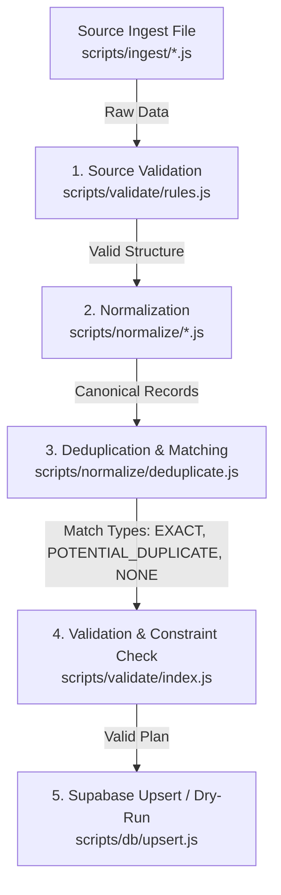

# NoCharity Ingestion Framework Architecture (Phase 4)

A lightweight, maintainer-driven, open-source data ingestion pipeline for NoCharity Advanced Mode.

---

## 1. Design Principles & Anti-Goals

The ingestion architecture is designed around strict data integrity, operational simplicity, and zero unnecessary infrastructure:

1. **Maintainer-Driven & Local-Only:**
   - ❌ **No continuous scraping:** Avoids anti-scraping blocks, legal complications, and proxy maintenance.
   - ❌ **No background workers or daemons:** Zero long-running background processes consuming server resources.
   - ❌ **No scheduled cloud crawlers:** Prevents unbounded billable cloud function or database compute consumption.
   - ✅ **Manual, local CLI invocation:** The maintainer runs ingestion scripts locally on-demand when updates are vetted.
2. **Deterministic Deduplication & Identity Resolution:**
   - Priority 1: **Stable Identifiers** (EIN, CIK, canonical URLs, Wikidata IDs).
   - Priority 2: **Conservative Matching** when stable identifiers are absent (Levenshtein distance $\le 2$, base entity name suffix stripping, 14-day temporal window for duplicate transactions).
   - ❌ **Strictly No Autonomous AI Identity Decisions:** Prevents non-deterministic merges or hallucinated donor linkage.
3. **Quality Protection Guardrails:**
   - Incoming lower-tier data **can never overwrite higher-tier verified data** without an explicit rule.
   - Existing populated fields cannot be overwritten by empty or null values.
4. **Dry-Run by Default:**
   - Maintains safety by allowing maintainers to inspect planned inserts, updates, duplicates, and validation errors before committing any database writes.

---

## 2. Directory Structure

```text
/scripts
  ├── /ingest                    # Source-specific ingestion adapters
  │     ├── index.js             # Source registry & aggregator
  │     ├── source-sec-form4.js  # SEC Form 4 regulatory filings
  │     └── source-giving-pledge.js # Giving Pledge & direct philanthropy
  ├── /normalize                 # Canonical data contracts & normalizers
  │     ├── index.js             # normalizeRecord() dispatcher
  │     ├── schemas.js           # Canonical constructors & clean helpers (cleanUrl, cleanEin, cleanCik)
  │     ├── deduplicate.js       # Matchers, conservative heuristics, quality protection
  │     ├── people.js            # Person normalization & alias deduplication
  │     ├── organizations.js     # Org normalization & type inference
  │     ├── sources.js           # Source URL cleaning & tier inference
  │     ├── wealth-snapshots.js  # Net worth parsing ($B strings) & date formatting
  │     └── donations.js         # Amount parsing & funding_source_type inference
  ├── /validate                  # Validation rules & constraint checkers
  │     ├── index.js             # validateRecord() master entrypoint
  │     └── rules.js             # Date formats, non-zero amounts, enum constraints
  ├── /seed                      # Baseline seed data
  │     └── seed-data.js         # Ingests initial roster from public/js/data.js
  ├── /db                        # Database integration
  │     ├── client.js            # Supabase client with SERVICE_ROLE key support
  │     └── upsert.js            # Ingestion planner, dry-run reporter & batch executor
  └── pipeline.js                # CLI runner (npm run ingest)
```

---

## 3. The 5-Stage Ingestion Pipeline

Every raw record follows an identical unidirectional pipeline before touching the database layer:



### Stage 1: Source Ingestion
Source files (e.g., `scripts/ingest/source-sec-form4.js`) produce raw, un-sanitized JavaScript objects from public APIs, downloaded filings, or curated files.

### Stage 2: Normalization
Raw records are converted into standardized, canonical records:
- **People:** First and last names split, aliases trimmed and deduplicated, external identifiers preserved.
- **Organizations:** Legal suffixes stripped for matching, organization types inferred (`FOUNDATION`, `COMPANY`, `DAF`, `CHARITY`, `POLITICAL_COMMITTEE`, `OTHER`), EINs formatted to `XX-XXXXXXX`, CIKs padded to 10 digits.
- **Sources:** URLs cleaned of tracking params (`utm_*`, `ref`, `fbclid`), hostnames lowercased and stripped of `www.`, source tiers assigned.
- **Wealth Snapshots:** Formatted string amounts (e.g. `"$135.5 Billion"`) parsed to exact numerical net worth, calendar dates standardized to `YYYY-MM-DD`.
- **Donations:** Amounts converted to positive floats, dates parsed to `YYYY-MM-DD`, funding source types inferred (`PERSONAL_FUNDS_CONFIRMED`, `PERSONAL_DIRECT`, `FOUNDATION`, `DAF`, `CORPORATE`, `PLEDGE`).

### Stage 3: Deduplication & Entity Resolution
Incoming records are checked against existing records in the database:
- **Exact Match:** Resolves existing ID and prepares field updates (governed by Quality Protection Rules).
- **Potential Duplicate:** Flagged with confidence score and reason in validation report; excluded from automatic write to prevent data corruption.
- **No Match:** Assigned a UUIDv4 and queued for insert.

### Stage 4: Validation
Comprehensive validation confirms all required fields are present, dates are valid calendar dates (between 1800 and 2050), amounts are positive non-zero numbers, and foreign keys resolve.

### Stage 5: Supabase Upsert / Dry-Run
- In **dry-run mode**, the plan outputs exact change counts and flagged potential duplicates without performing writes.
- In **commit mode**, operations are executed in dependency order (`people` → `organizations` → `sources` → `wealth_snapshots` → `donations` → `donation_sources`).

---

## 4. Common Normalized Record Formats

### 4.1 People
```json
{
  "entity_type": "PERSON",
  "canonical_name": "Warren Edward Buffett",
  "first_name": "Warren Edward",
  "last_name": "Buffett",
  "aliases": ["Warren Buffett", "Oracle of Omaha"],
  "country": "United States",
  "birth_date": "1930-08-30",
  "occupation": "Investor & Philanthropist",
  "industry": "Finance / Investments",
  "description": "Chairman and CEO of Berkshire Hathaway",
  "is_billionaire": true,
  "identifiers": {
    "wikidata_id": "Q47213",
    "forbes_id": "warren-buffett"
  }
}
```

### 4.2 Organizations
```json
{
  "entity_type": "ORGANIZATION",
  "legal_name": "Bill & Melinda Gates Foundation",
  "display_name": "Gates Foundation",
  "organization_type": "FOUNDATION",
  "ein": "56-2618866",
  "cik": "0001092657",
  "country": "United States",
  "website": "https://gatesfoundation.org",
  "description": "Private philanthropic foundation founded by Bill Gates and Melinda French Gates"
}
```

### 4.3 Sources
```json
{
  "entity_type": "SOURCE",
  "url": "https://sec.gov/Archives/edgar/data/1067983/000119312525145892/form4.xml",
  "title": "SEC Form 4 Statement of Changes in Beneficial Ownership - Berkshire Hathaway Inc",
  "publisher": "U.S. Securities and Exchange Commission",
  "published_at": "2025-06-28",
  "source_tier": "PRIMARY_REGULATORY"
}
```

### 4.4 Wealth Snapshots
```json
{
  "entity_type": "WEALTH_SNAPSHOT",
  "person_id": "00000000-0000-0000-0000-000000000001",
  "person_name": "Warren Buffett",
  "snapshot_date": "2025-06-28",
  "net_worth": 135500000000,
  "source_name": "Bloomberg Billionaires Index",
  "source_url": "https://bloomberg.com/billionaires/profiles/warren-e-buffett",
  "confidence": "HIGH"
}
```

### 4.5 Donations
```json
{
  "entity_type": "DONATION",
  "donor_person_id": "00000000-0000-0000-0000-000000000001",
  "donor_person_name": "Warren Buffett",
  "recipient_organization_name": "Bill & Melinda Gates Foundation",
  "amount": 5300000000,
  "currency": "USD",
  "donation_date": "2025-06-28",
  "cause_category": "Global Health & Development",
  "funding_source_type": "PERSONAL_FUNDS_CONFIRMED",
  "status": "VERIFIED",
  "source_url": "https://sec.gov/Archives/edgar/data/1067983/000119312525145892/form4.xml",
  "corroborating_source_urls": [
    "https://gatesfoundation.org/ideas/media-center/press-releases/2025/06/buffett-annual-gift"
  ],
  "description": "Annual Berkshire Hathaway Class B share donation to Gates Foundation"
}
```

---

## 5. Deduplication & Entity Resolution Specification

### 5.1 Stable Identifiers (Exact Matching)
When available, matching is prioritized on verifiable government, regulatory, or canonical identifiers:

| Entity | Primary Stable Identifiers | Secondary Stable Identifiers |
| :--- | :--- | :--- |
| **People** | `identifiers.wikidata_id`, `canonical_name` | Existing alias exact match, incoming alias match |
| **Organizations** | `ein` (9-digit US tax ID), `cik` (10-digit SEC ID) | `legal_name` exact match, canonical `website` domain match |
| **Sources** | Canonical `url` (tracking stripped, lowercase, host-normalized) | Title + Publisher + Date exact match |
| **Wealth Snapshots** | Composite `(person_id, snapshot_date)` | N/A |
| **Donations** | Composite `(donor_id, donation_date, amount)` | N/A |

### 5.2 Conservative Matching (Flags Potential Duplicates)
Where stable identifiers are absent, conservative heuristics prevent silent duplicate creation:
1. **People:** Names with a Levenshtein distance $\le 2$ (or shared last name and identical birth date) are flagged as `POTENTIAL_DUPLICATE` rather than merged or inserted.
2. **Organizations:** Names with stripped legal suffixes (`Inc`, `Corp`, `LLC`, `Foundation`, `Trust`, `The`, `Of`, `And`) matching an existing entity without an EIN match are flagged as `POTENTIAL_DUPLICATE`.
3. **Donations:** Donations for the identical amount and identical donor recorded within a **14-day temporal window** are flagged as `POTENTIAL_DUPLICATE` to prevent double-counting multi-source reporting of the same pledge fulfillment.

### 5.3 Deterministic Heuristics Only (No AI Decisions)
All deduplication logic in `scripts/normalize/deduplicate.js` uses deterministic string and date heuristics.
Autonomous LLM/AI identity resolution is explicitly forbidden from running unattended on ingestion to eliminate non-deterministic data drift.

---

## 6. Quality Protection Rules

The framework enforces strict hierarchy weights to guarantee that incoming low-quality or secondary reporting never overwrites authoritative regulatory or verified data:

### 6.1 Source Tier Hierarchy
```text
PRIMARY_REGULATORY (5) > OFFICIAL_PRESS_RELEASE (4) > INVESTIGATIVE_REPORT (3) > SECONDARY_NEWS (2) > DISPUTED (1)
```
- Example: An SEC Form 4 citation (`PRIMARY_REGULATORY`) cannot be downgraded or replaced by a blog post or aggregator link (`SECONDARY_NEWS`).

### 6.2 Wealth Snapshot Confidence Hierarchy
```text
HIGH (4) > MEDIUM (3) > ESTIMATE (2) > DISPUTED (1)
```
- Example: A valuation calculated from verified regulatory share filings (`HIGH`) cannot be overwritten by an unverified gossip estimate (`ESTIMATE`).

### 6.3 Donation Verification Status Hierarchy
```text
VERIFIED (4) > PARTIALLY_VERIFIED (3) > PENDING (2) > DISPUTED (1)
```
- Example: A `VERIFIED` gift confirmed by recipient disclosure cannot be demoted to `PENDING`.

### 6.4 Null Value Preservation
- An incoming `null`, `undefined`, or empty string can **never** overwrite an existing populated value.

---

## 7. Maintainer CLI & Command Reference

### Running Dry-Run (Default & Recommended)
Inspect planned database modifications without writing anything:
```bash
npm run ingest -- --dry-run
```

### Committing Ingestion to Supabase
Commit vetted updates directly into the database:
```bash
npm run ingest -- --commit
```
*(Requires `SUPABASE_SERVICE_ROLE_KEY` in `.env` for table write permissions).*

### Targeting a Specific Source
Ingest only from a specific adapter:
```bash
npm run ingest -- --source sec-form4 --dry-run
npm run ingest -- --source giving-pledge --dry-run
npm run ingest -- --source seed --dry-run
```

---

## 8. Validation Output Specification

Every execution produces a structured summary report in the console:

```text
============================================================
🔍 NOCHARITY INGESTION PLAN (DRY-RUN MODE)
============================================================
New people: 1
Updated people: 1
New organizations: 1
Updated organizations: 1
New sources: 4
Updated sources: 0
New wealth snapshots: 1
Updated wealth snapshots: 3
New donations: 1
Updated donations: 3
Potential duplicates: 0
Invalid records: 0
------------------------------------------------------------
```

When potential duplicates or validation issues occur, detailed diagnostics are emitted:
```text
⚠️ POTENTIAL DUPLICATES DETECTED (Review Required):
  [PERSON] "Warren Bufft" -> Matched with existing "Warren Buffett"
    Reason: Close name edit distance (2) between "Warren Bufft" and "Warren Buffett"

❌ INVALID RECORDS (Skipped):
  [PERSON] Record: {"canonical_name":""}
    Errors: canonical_name is required and must not be empty
```

---

## 9. Adding a New Ingestion Source

To add a new source (e.g. `scripts/ingest/source-forbes-realtime.js`), follow these 3 steps:

1. **Create the Ingest File:**
   ```javascript
   // scripts/ingest/source-forbes-realtime.js
   import {
     createNormalizedPerson,
     createNormalizedWealthSnapshot,
     createNormalizedSource
   } from '../normalize/schemas.js';

   export async function ingestForbesRealtime() {
     // 1. Fetch or load local file
     // 2. Normalize records
     const sources = [
       createNormalizedSource({
         url: 'https://forbes.com/billionaires',
         title: 'Forbes Real-Time Billionaires List',
         publisher: 'Forbes',
         source_tier: 'SECONDARY_NEWS'
       })
     ];
     const wealthSnapshots = [
       createNormalizedWealthSnapshot({
         person_name: 'Elon Musk',
         snapshot_date: '2026-10-21',
         net_worth: 245000000000,
         source_name: 'Forbes',
         source_url: 'https://forbes.com/billionaires',
         confidence: 'MEDIUM'
       })
     ];
     return { people: [], organizations: [], sources, wealthSnapshots, donations: [] };
   }
   ```

2. **Register the Source in `scripts/ingest/index.js`:**
   ```javascript
   import { ingestForbesRealtime } from './source-forbes-realtime.js';

   export const SOURCE_REGISTRY = {
     'sec-form4': ingestSecForm4,
     'giving-pledge': ingestGivingPledge,
     'forbes-realtime': ingestForbesRealtime,
     'seed': ingestSeedData
   };
   ```

3. **Validate with Dry-Run:**
   ```bash
   npm run ingest -- --source forbes-realtime --dry-run
   ```
   The pipeline will validate schemas, match against existing database records, apply quality protection, and output the report without requiring any modifications to the core database or upsert logic.
